<p align="center">
  
</p>

<p align="center">
  <a href="https://oguzhankodal.github.io">
    
  </a>
</p>

<p align="center">
  <a href="https://oguzhankodal.github.io"></a>
  <a href="https://apps.apple.com/tr/app/bidaha/id6820660223"></a>
  <a href="https://www.instagram.com/oguzwith"></a>
</p>

---

> 🇬🇧 **AI engineer building real products with LLMs and coding agents — from idea to App Store.**

## 👋 Merhaba, ben Oğuz

Yazılımcıyım. Eğitimim **Matematik ve Bilgisayar Bilimleri** ile **Yönetim Bilişim Sistemleri** üzerine tamamladım. Bu bölümler bana hem algoritma tarafını hem de işin iş/ürün tarafını yönetebilmeyi sağladı. Yapay zekâyı bir oyuncak değil **üretim aracı** olarak kullanıyorum: fikri bir AI ajanla birlikte tasarlıyor, kodluyor ve mağazaya kadar götürüyorum.

```ts
const oguz = {
  rol: "AI Engineer",
  eğitim: ["Matematik ve Bilgisayar Bilimleri", "Yönetim Bilişim Sistemleri"],
  odak: ["LLM uygulamaları", "AI ajanları", "prompt engineering", "mobil"],
  araçlar: ["Claude", "Claude Code", "Expo", "SwiftUI", "Django"],
  şuAn: "biDaha'yı App Store'a çıkardım, sırada AI destekli yeni ürünler var",
};
```

## 🧠 AI tarafı

<p>
  
  
  
  
  
</p>

- 🤖 Kod yazarken AI ajanlarıyla çalışıyorum (Claude Code) — planlama, kod, test, yayın
- 🧩 Prompt engineering ve ajan iş akışları kuruyorum
- 🗂️ Kendi "ikinci beyin" sistemimi AI ile işletiyorum: notlar, projeler, hafıza
- 🎥 Öğrendiklerimi Instagram'da [@oguzwith](https://www.instagram.com/oguzwith) hesabında paylaşıyorum

## 🛠️ Teknolojiler

<p align="center">
  
</p>

## 🚀 Öne çıkan projeler

| Proje | Ne yapıyor | Teknoloji |
|---|---|---|
| 📚 **[biDaha](https://github.com/OguzhanKodal/biDaha)** | Çözemediğin soruları kaydedip tekrar çözdüren "yanlış soru defteri" — [App Store'da](https://apps.apple.com/tr/app/bidaha/id6820660223) | Expo · React Native · TypeScript · Swift |
| ⏱️ **[1-5-25 FocusApp](https://github.com/OguzhanKodal/1-5-25-FocusApp)** | 1-5-25 yöntemiyle odaklanma programı | Swift · SwiftUI |
| 📖 **[Okuma & Ezber Takip](https://github.com/OguzhanKodal/okuma-ezber-takip-sitesi)** | Okuma ve ezber ilerlemesini takip eden web uygulaması | Django · Python |
| 🏠 **[Emlak Sitesi](https://github.com/OguzhanKodal/emlak-sitesi)** | İlan yayınlama ve listeleme sitesi (bitirme projesi) | Django · Python · JS |
| 🔗 **[oguz/with](https://github.com/OguzhanKodal/oguzhankodal.github.io)** | Tüm linklerimin olduğu kişisel sayfa | HTML · CSS |

## 📊 GitHub

<p align="center">
  
  
</p>

<p align="center">
  
</p>
